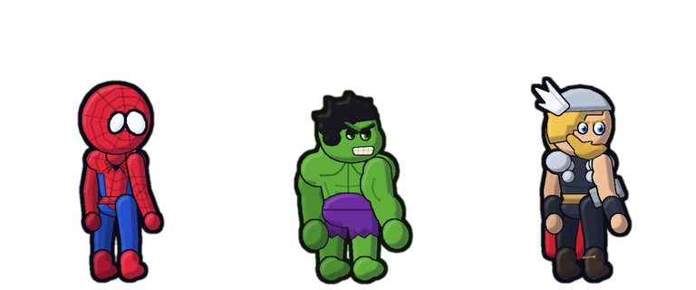

# Webling — Your Tiny Web Hero 🕸️

Webling is a delightful, privacy-first Manifest V3 browser extension for Google Chrome and Microsoft Edge. It brings a cartoon hero companion to life on your webpages to support your daily focus sessions, track hydration, rescue tiny spiders, provide page insights, and unlock cosmetic rewards.



---

## 🌟 Feature Overview

- **Interactive Webpage Companion**:
  - Rendered in an isolated Shadow DOM (`mode: 'closed'`) so webpage styles never clash with Webling and Webling never pollutes webpage styles.
  - Idle hanging with gentle swaying physics.
  - Direction-aware movement: Webling faces left or right based on drag velocity or swing direction.
  - Multi-frame sprite animation: anticipation pose, in-flight swing curve, recovery landing, and idle hanging.
  - Interactive web-line rendering that accurately tracks Webling's hand in real time.
  - Dragging via mouse, touch, or pen (Pointer Events with capture).
  - Keyboard activation (Enter/Space on focused character) and `Alt+Shift+S` global shortcut.
  - Rare slip-and-self-rescue mishap animation with comedic recovery.
  - Contextual speech bubbles with 3 distinct personalities and over 150 unique dialogue lines.
  - Non-intrusive: links, buttons, inputs, text selection, and scrolling on the host page remain 100% interactive and unblocked.
  - Optional "Swing to page clicks" mode (disabled by default; ignores interactive elements, forms, links, buttons, and media controls when enabled).

- **Pick Your Hero** (Customize → Hero):
  - **Web-Slinger**: red-and-blue masked hero with big white lenses.
  - **Green Giant**: huge green brute in torn purple shorts.
  - **Thunder Warrior**: winged helm, red cape and a lightning hammer.
  - **Classic**: the original pixel sprite.
  - Five sizes: Tiny (40px), Mini (52px), Small (64px), Medium (88px), Large (112px).

- **Hero Squad** (Customize → Hero Squad, off by default):
  - The heroes you didn't pick stroll along the bottom of the page, stopping now and then.
  - **Squad Scuffles**: every so often two of them meet up and trade a few punches (POW! BAM!), then walk off.
  - Never blocks the page (no pointer events), stays clear of the water widget, hides during Focus Patrol, and stands still with reduced motion.

- **Three Expressive Personalities**:
  - **Cheeky**: Witty, playful, sarcastic, fourth-wall breaking, pun-heavy.
  - **Brave**: Heroic, dramatic, confident, encouraging, action-oriented.
  - **Calm**: Zen, gentle, mindful, reassuring, nature-inspired.
  - Unique dialogue across 12 categories: greetings, summoning, interactions, focus session start/pause/complete, hydration reminders/completion, spider rescues, reward unlocks, slip recoveries, and general encouragement.
  - Quiet mode suppresses unsolicited dialogue while preserving direct user action feedback.

- **Authoritative Focus Patrol & Focus Timer**:
  - Persistent timer owned by the background service worker using `chrome.alarms` and timestamps.
  - Survives popup closure, tab switching, page refresh, service worker suspension, and browser restarts.
  - Presets for 15, 25, 45, and 60 minutes, plus custom durations from 1 to 180 minutes.
  - Start, Pause, Resume, Reset controls.
  - Optional 5-minute break timer with automatic break trigger upon completion.
  - Floating, non-intrusive countdown badge on the webpage (hideable).
  - Optional non-destructive video dimming during Focus Patrol sessions.
  - Full streak tracking (current streak and best streak).

- **Daily Hydration System**:
  - Daily target tracker (default 8 glasses, configurable from 4 to 12).
  - Quick +1 and undo -1 buttons both in the popup and floating webpage widget.
  - Resets automatically on local calendar date midnight rollover.
  - Historical completion dates preserved for accurate streak calculation.
  - Scheduled hydration reminder alarms (30, 45, 60, 90 minutes) with quiet-hours suppression and goal-reached suppression.

- **Tiny Spider Rescue Activity**:
  - Crawling pixel spiders spawn occasionally with a cooldown (never permanently cluttering the page).
  - Keyboard-accessible button with pop animation on rescue.
  - Rescues increment your total career score, triggering celebration dialogue, achievements, and cosmetic unlocks.
  - Respects quiet mode, Focus Patrol, and reduced motion.

- **Progression & Unlockable Cosmetics**:
  - Tracks total spiders rescued, focus sessions completed, focus minutes, focus streaks, hydration goals, hydration streaks, and pages patrolled.
  - **12 Achievements**: *First Swing*, *First Rescue*, *Web Saver*, *Arachnid Ally*, *Centurion*, *First Focus*, *Deep Focus*, *Focus Streak*, *Hydration Hero*, *Three-Day Streak*, *Week of Water*, *Veteran Webling*.
  - **9 Cosmetic Rewards**:
    - Web line styles: *Crimson Thread* (red), *Golden Strand* (gold), *Prismatic Web* (rainbow).
    - Character themes: *Midnight* (dark blue filter), *Sunset Glow* (warm sepia filter).
    - Speech bubbles: *Pixel Talk* (retro border).
    - Badges: *Gold Star* (⭐), *Crown* (👑).
    - Effects: *Sparkle Landing* (particle burst on landing).
  - Live equipping with instantaneous cross-tab synchronization.

- **Page Intelligence (Page Intel)**:
  - Clean extraction of webpage word count, estimated reading time (0 min if no text), total link count, heading count, and image count.
  - Ignores scripts, styles, templates, noscript tags, and extension elements.
  - Refresh action button to re-scan dynamic single-page applications.

- **First-Run Onboarding Tour & Local Privacy**:
  - 5-step guided onboarding card explaining summoning, dragging, Focus Patrol, water tracking, spider rescues, and privacy.
  - Reopenable at any time from the Settings tab in the popup.
  - 100% local: zero remote scripts, zero remote fonts, zero analytics, zero external network requests, zero accounts.

---

## 🚀 Local Installation

### Google Chrome
1. Open Chrome and navigate to `chrome://extensions/`.
2. Enable **Developer mode** using the toggle in the top-right corner.
3. Click **Load unpacked** in the top-left corner.
4. Select the `dist/webling` folder (run `npm run build` first; see **Clean Build** below), or this project folder for development.
5. Click the puzzle icon in the Chrome toolbar and pin **Webling**.

### Microsoft Edge
1. Open Edge and navigate to `edge://extensions/`.
2. Turn on **Developer mode** in the left sidebar.
3. Click **Load unpacked**.
4. Select the `dist/webling` folder (or this project folder for development).
5. Pin Webling to the Edge toolbar for easy access.

---

## 🎮 How to Use Webling

- **Summon Webling**:
  - Press `Alt + Shift + S` on any supported webpage (`http://`, `https://`, or `file://`).
  - Or click the **Summon Webling** button in the extension popup.
- **Move Webling**:
  - Click and drag Webling to any position on the screen. Release to anchor his web strand.
  - Click on Webling without dragging to make him swing playfully to a new location.
  - Press `Enter` or `Space` while Webling is focused via keyboard to trigger a swing.
- **Enable / Disable per Site**:
  - Open the popup on any tab to view the active hostname.
  - Click **Disable on site** to hide Webling on that specific domain without affecting other sites.
  - Toggle the master switch in the header to globally disable or enable Webling everywhere.
- **Start Focus Patrol**:
  - Switch to the **Focus** tab in the popup.
  - Select a preset (15m, 25m, 45m, 60m) or enter a custom duration (1–180m).
  - Click **Start Session**. Webling will quiet down, suppress mishaps, and display a floating countdown badge on your page.
- **Track Water**:
  - Click `+` or `−` on the bottom-right webpage widget, or use the quick buttons on the **Home** tab of the popup.

---

## 🔒 Privacy & Permissions

Webling is built strictly as a local companion:
- **No external servers**: All state is stored locally via `chrome.storage.local`.
- **No analytics or telemetry**: Webling never collects, tracks, or transmits your browsing data.
- **Page stats calculated locally**: Text analysis runs in memory inside your browser and is never stored or transmitted.

### Manifest Permissions Explained
| Permission | Reason |
| :--- | :--- |
| `storage` | Stores user settings, focus sessions, hydration history, achievements, and unlocked cosmetics locally. |
| `activeTab` | Inspects the current page hostname and computes local page reading stats when the popup is opened. |
| `scripting` | Enables fallback injection of the companion when using `Alt+Shift+S` on tabs opened prior to extension installation. |
| `alarms` | Authoritative background timer for Focus sessions, scheduled hydration reminders, and midnight rollover checks. |
| `notifications` | Displays local desktop notifications when a Focus session completes, when daily water goals are met, or when hydration reminders fire. |

---

## 📦 Clean Build

```bash
npm run build        # or: node scripts/build.mjs
```

This runs the test suite, copies only the files the extension needs into `dist/webling/`, checks that every file referenced by the manifest, pages and scripts is present, and packs `dist/webling-<version>.zip`. No dependencies needed, just Node 18+.

---

## 🧪 Testing and Test Harness

### Automated Test Suite
Run the automated test suite in Node.js (covers storage validation, v1→v2 migration, achievements, cosmetics, dialogue, timer math, site matching, and manifest integrity):

```bash
npm test             # or: node tests/test-suite.mjs
```

### Visual Overlay Harness
Open `tests/overlay-harness.html` directly in your browser:
- Tests the companion overlay, dragging, and swinging in an isolated sandbox.
- Contains an interactive developer dock to test summoning, personality swaps, character sizes, Focus Patrol state changes, hydration reminders, and cosmetic badges.
- Confirms that webpage links, buttons, and form inputs are never blocked by Webling.

### Preview Character Assets
Open `preview.html` in your browser to inspect the hero sprite strip at 48px, 80px, 120px, and 160px display sizes.

### Regenerating Hero Sprites
The hero art is drawn by code, not by hand. `scripts/build-hero-sprites.py` (needs Pillow) renders each hero's 8-frame strip (`assets/hero-*.png`: hang, anticipate, flight, recover, stand, walk ×2, punch), the onboarding lineup and the toolbar icons. Tweak poses, proportions or colours there and rerun:

```bash
npm run sprites      # or: python scripts/build-hero-sprites.py
```

---

## 📁 Project Structure

```text
Spoidermon/
├── manifest.json              # Manifest V3 extension configuration
├── package.json               # npm scripts: test, build, sprites (no dependencies)
├── background.js              # Service worker (alarms, focus timer, rollover, notifications)
├── content.js                 # Content script (Shadow DOM, hero, web line, squad, widgets)
├── popup.html / .css / .js    # 5-tab extension popup
├── onboarding.html / .css / .js  # First-run guided tour
├── preview.html               # Sprite preview at several display sizes
├── assets/
│   ├── icon-16/32/48/128.png  # Toolbar and store icons
│   ├── hero-webling.png       # 8-frame hero sprite strips
│   ├── hero-titan.png
│   ├── hero-stormbringer.png
│   ├── hero-classic.png       # Original pixel sprite in the 8-frame layout
│   ├── hero-lineup.png        # All heroes standing (onboarding, README)
│   └── webling-cute-reference-strip.png  # Source for hero-classic.png (not shipped)
├── modules/
│   ├── storage.js             # Storage schema v2, defaults, validation, migrations
│   ├── achievements.js        # 12 achievements and 9 cosmetics
│   └── dialogue.js            # Cheeky, Brave and Calm dialogue banks
├── scripts/
│   ├── build.mjs              # Clean build → dist/webling + zip
│   └── build-hero-sprites.py  # Renders hero strips, lineup and icons
└── tests/
    ├── overlay-harness.html   # Isolated test page with a developer dock
    └── test-suite.mjs         # Automated unit/integration tests
```

---

## ⚠️ Known Browser Limitations

1. **Restricted Browser Pages**:
   - Web browsers (Chrome and Edge) intentionally prohibit extension content scripts from executing on internal URLs (e.g. `chrome://*`, `edge://*`, `chrome-extension://*`, `about:*`, or the Chrome Web Store / Edge Add-ons catalog).
   - On these pages, Webling gracefully displays an explanatory "Restricted browser page" banner in the popup without throwing errors.
2. **First Run on Pre-existing Tabs**:
   - Tabs that were already open before loading the extension may require a one-time page refresh or summoning via `Alt+Shift+S` to inject the content script.
